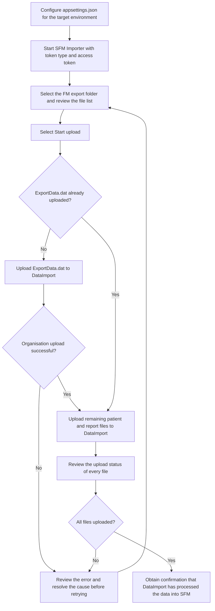

# SFM Importer

## Introduction

SFM Importer uploads FM export files to the SFM DataImport service. Users can select an export folder, monitor the upload status of individual files, and retry uploads that have not completed.

This guide describes how to configure and use the distributed Windows application.

## Prerequisites

Before using the application, ensure that the following are available:

- A Windows computer with SFM Importer installed.
- .NET 10 Desktop Runtime for Windows installed. This is required to run the application; the .NET SDK is not required for end users.
- An FM export folder and permission to read and write files in that folder.
- Network access to the DataImport service in the target environment.
- The service addresses and a valid access token provided by the environment administrator.
- For DPoP authentication, the secret key supplied by HelseID for generating DPoP proofs.

Confirm the target environment before uploading data. Replace all example values in this guide with the settings supplied for that environment.

## Upload Files

Select the main export folder with the following structure:

```text
FMExport/
├── ExportData.dat
├── Patients/
│   └── patient files (.pat)
└── Reports/
    └── report files (.rpt)
```

| File or folder | Content | Upload order |
| --- | --- | --- |
| `ExportData.dat` | Organisation data | Uploaded first. This upload must complete before the remaining files can be uploaded. |
| `Patients` | Patient files | Uploaded after the organisation file. |
| `Reports` | Report files | Uploaded after the organisation file, alongside patient files. Neither category has priority over the other. |

`ExportData.dat` must be located directly in the selected folder. The application does not allow an upload to start if this file is missing.

The application searches the selected folder and its subfolders for files with the lowercase extensions `.dat`, `.pat`, and `.rpt`. It uploads eligible files that are not already marked as completed. Individual files cannot be selected for upload separately.

Use a folder containing only the intended export. Other files with these extensions may also be listed and uploaded. Files with other extensions, including `.xml`, `.zip`, and `.pdf`, are excluded.

## Upload Flow



The upload consists of the organisation file (`ExportData.dat`), followed by the eligible files in the export folder, including patient files in `Patients` and report files in `Reports`. Files already recorded as completed are skipped. Upload progress is saved in `.ledger`; this file is used locally and is not uploaded to DataImport.

## Configuration

Close the application and open the supplied `appsettings.json` file in a text editor. Keep a copy before making changes.

### Example Configuration

```json
{
  "AppSettings": {
    "UploadAPI": "https://dataimport.[env].forskrivning.no/files",
    "UploadV2API": "https://dataimport.[env].forskrivning.no/v2/files",
    "LogFile": "C:/SFM/Logs/importer.log",
    "UploadThreads": "1",
    "Folder": "C:/SFM/FMExport",
    "EnableProxy": false,
    "EpjSecret": "HELSEID-SECRET-KEY-FOR-DPOP-PROOFS"
  },
  "Serilog": {
    "MinimumLevel": "Information"
  }
}
```

The DataImport base address follows the pattern `https://dataimport.[env].forskrivning.no`. Replace `[env]`, including the square brackets, with the target environment name supplied by the environment administrator. For example, for the `test6` environment, use:

- Bearer: `https://dataimport.test6.forskrivning.no/files`
- DPoP: `https://dataimport.test6.forskrivning.no/v2/files`

`[env]` is a placeholder and must not remain in the saved configuration. Both addresses must refer to the intended environment, and the access token must be valid for that environment.

### Configuration Settings

| Setting | Description |
| --- | --- |
| `UploadAPI` | Upload address used for Bearer authentication. Obtain the complete address from the environment administrator. |
| `UploadV2API` | Upload address used for DPoP authentication. Obtain the complete address from the environment administrator. |
| `LogFile` | Location of the activity and error log. Select a location where the current user has write permission. |
| `UploadThreads` | Maximum number of files uploaded simultaneously. Use the value agreed with the service administrator. A value of `1` uploads one file at a time. |
| `Folder` | Main export folder containing `ExportData.dat`. This folder is loaded when the application starts. A different folder can be selected in the application. |
| `EnableProxy` | Set to `true` when access requires the proxy configured in Windows; otherwise, use `false`. Confirm this setting with local support. |
| `EpjSecret` | Secret key supplied by HelseID for generating DPoP proofs. This is not the user's password. It is not used for Bearer authentication. |
| `MinimumLevel` | Level of detail recorded in the log. Retain `Information` unless instructed otherwise by support. |

Use forward slashes (`/`) in paths, as shown above. Preserve the quotation marks and commas. The values `true` and `false` must not be enclosed in quotation marks. Save the file before restarting the application.

The access token is supplied when starting the application. It is not entered in this configuration file. Do not disclose access tokens or the `EpjSecret` secret key to unauthorised parties.

## Starting the Application

The application requires two arguments, in this order:

```text
SFM.Importer.exe [token-type] [token]
```

| Argument | Required value |
| --- | --- |
| `[token-type]` | `Bearer` or `DPoP`, according to the authentication type of the supplied token. |
| `[token]` | The complete, valid access token supplied for the target environment. |

The square brackets indicate placeholders. Replace them with the actual values and omit the brackets. Both arguments are required.

1. Save the correct environment settings in `appsettings.json`.
2. Open PowerShell in the folder containing `SFM.Importer.exe` and that configuration file.
3. Run one of the following commands, replacing `ACCESS-TOKEN` with the complete token. Keep the quotation marks around the token.

For Bearer authentication:

```powershell
.\SFM.Importer.exe Bearer "ACCESS-TOKEN"
```

For DPoP authentication:

```powershell
.\SFM.Importer.exe DPoP "ACCESS-TOKEN"
```

Replace `ACCESS-TOKEN` with a valid token. For DPoP authentication, also ensure that `EpjSecret` contains the secret key supplied by HelseID for generating DPoP proofs. The application cannot be used by opening the executable without supplying an authentication type and access token.

The export folder is configured through `Folder` in `appsettings.json` or selected in the application window; it is not supplied as an additional startup argument.

## Upload Procedure

1. Verify the folder displayed in the application. To change it, select **Velg en mappe...** (Select a folder).
2. Select the main export folder containing `ExportData.dat`.
3. Review the file list and upload statuses. Confirm that the listed files belong to the intended export.
4. Select **Start opplastning** (Start upload).
5. Monitor the status of each file until the upload attempt has finished.

Folder selection and the start button are disabled during upload. The organisation file is uploaded first. The remaining files are uploaded only after that upload has completed successfully.

### File List

| Application column | Description |
| --- | --- |
| `Filnavn` | File name and location within the export folder. |
| `Filtype` | File category: organisation, patient, or report. `Ukjænt fil` means unknown file type; verify the file before uploading. |
| `Status på opplastning` | Upload status of the file. |

## Upload Status and Completion

| Application status | Meaning |
| --- | --- |
| `Ikke begynnt` | The upload has not started. |
| `Opplasting pågår` | The upload is in progress, or was recorded as started during an earlier attempt. |
| `Opplasting ferdig` | The file upload has completed. |
| `Oplasting feilet` | The file upload failed. |

When the application reports that the upload attempt has finished, check the status of every file. The overall completion message does not guarantee that all files were uploaded successfully.

A completed upload confirms that the file has been transferred to DataImport. Obtain confirmation from the service administrator that the data has subsequently been processed and imported into SFM.

## Cancellation and Retry

Select **Avbryt opplastning** (Cancel upload) to request cancellation, then wait for confirmation. An upload already in progress may continue until that operation finishes. Cancellation may therefore take some time.

Upload progress is saved in a file named `.ledger` in the export folder. Keep this file and the original export files in their existing locations when retrying an upload.

When the same folder is selected again, the application loads the saved file statuses. Files marked as completed are skipped. Other files are attempted again. An interrupted upload may resume from its previous progress if the service still supports resuming that upload.

Resolve the cause of a failure before retrying and confirm that the access token is still valid. If a replacement token is required, close the application and restart it with the new token.

## Troubleshooting

| Issue | Recommended action |
| --- | --- |
| The application reports a missing token | Start the application with the authentication type and access token described above. |
| The authentication type is rejected | Use `Bearer` or `DPoP`, according to the supplied access credentials. |
| The export folder is rejected | Confirm that `ExportData.dat` is located directly in the selected folder. |
| Expected files are missing from the list | Check the selected folder and the lowercase extensions `.dat`, `.pat`, and `.rpt`. Select the folder again if files were added after it was loaded. |
| Only the organisation file was attempted | Check whether the upload of `ExportData.dat` failed. All other uploads depend on its successful completion. |
| Upload fails because access is denied | Check the token validity, target environment, and authentication type. For DPoP, also verify the HelseID secret key configured in `EpjSecret`. |
| The service cannot be reached | Check the service addresses, network connection, and proxy settings where applicable. |
| Progress or logs cannot be saved | Check write permissions for the export folder and the location specified in `LogFile`. |
| Configuration cannot be loaded | Check quotation marks, commas, and paths in `appsettings.json`. Verify that the application was started from the folder containing the intended configuration file. |

If the issue persists, provide support with the time of the attempt, the target environment, the displayed error message, and the log specified in `LogFile`. Review the log before sharing it, as it may contain file names and service addresses. Do not provide the access token or secret key.
